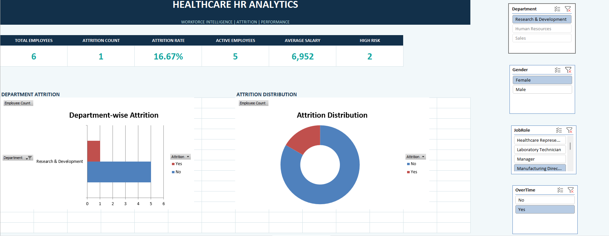
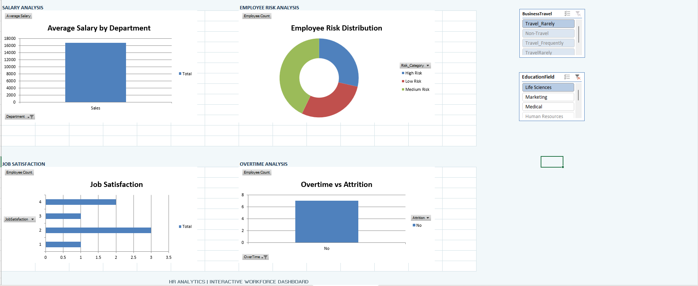
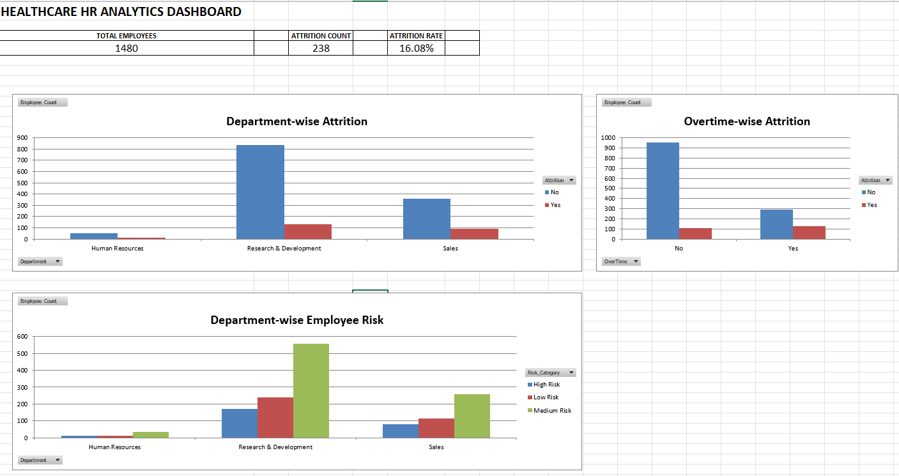
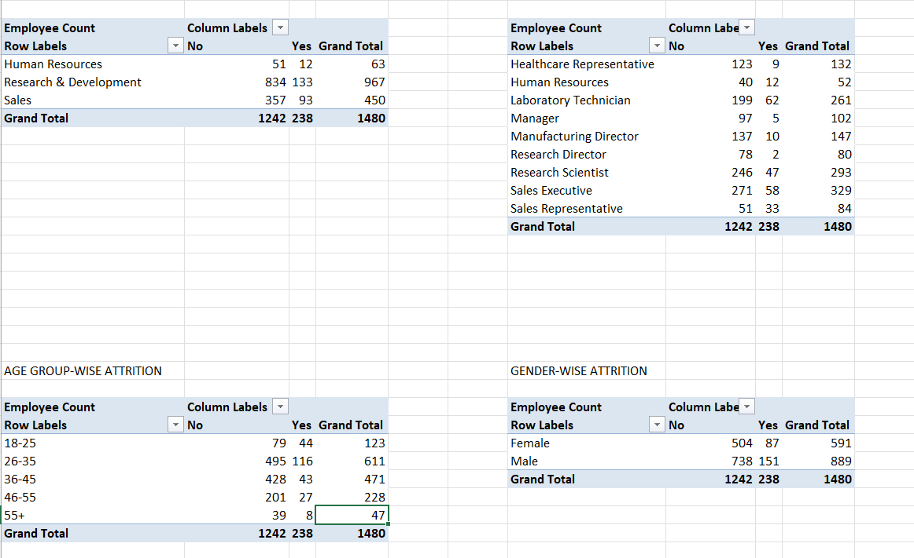
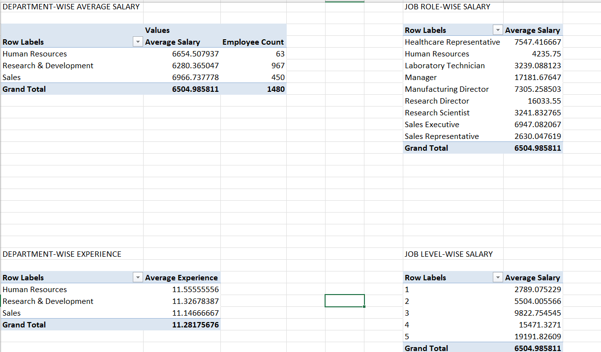
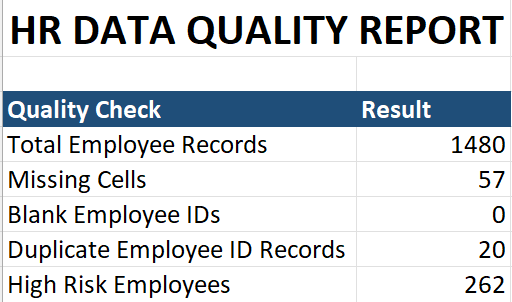

# 🏥 Healthcare HR Analytics Dashboard | Excel VBA

### Interactive HR Analytics & Workforce Intelligence Dashboard using Microsoft Excel


---

## 📌 Project Overview

The Healthcare HR Analytics Dashboard is an Excel-based data analytics project developed using VBA Macros, Pivot Tables, KPI Cards, Charts, and interactive filtering.

The project focuses on transforming raw employee data into meaningful workforce insights to support HR analysis and data-driven decision-making.

A professional healthcare-inspired dashboard theme is used to present employee attrition, workforce distribution, salary analysis, employee satisfaction, and overtime patterns.

**Note:** The underlying dataset contains general HR employee information. Healthcare refers to the dashboard's visual theme, not the dataset's industry.

---

## 🎯 Project Objectives

- Clean and preprocess employee data using VBA.
- Automate repetitive Excel operations.
- Perform feature engineering.
- Analyze employee attrition across departments.
- Evaluate salary and workforce distribution.
- Analyze employee satisfaction and overtime.
- Build an interactive Excel dashboard.

---

## 🛠️ Tools & Technologies

| Tool | Application |
|---|---|
| Microsoft Excel | Data Analysis |
| VBA Macros | Automation |
| Pivot Tables | Data Summarization |
| Pivot Charts | Data Visualization |
| Excel Slicers | Interactive Filtering |
| KPI Cards | Performance Monitoring |

---

## 📊 Dashboard Screenshots

### 1. Main HR Analytics Dashboard



### 2. HR Dashboard Overview



### 3. Workforce Dashboard



### 4. Employee Attrition Analysis



### 5. Workforce Analysis



### 6. Data Quality Report



---

## 📈 Key Performance Indicators

| KPI | Description |
|---|---|
| Total Employees | Total employee records |
| Attrition Count | Employees who left |
| Attrition Rate | Percentage of employees who left |
| Active Employees | Employees currently working |
| Average Salary | Average monthly income |
| High Risk Employees | Employees classified as high risk |

---

## 🔍 Analytical Areas

### Employee Attrition Analysis
- Department-wise attrition
- Gender-wise attrition
- Job role-wise attrition
- Overtime-wise attrition

### Workforce Analysis
- Department distribution
- Salary analysis
- Job role distribution
- Employee experience

### Employee Satisfaction
- Job satisfaction
- Work-life balance
- Environment satisfaction

### Data Quality
- Missing value identification
- Duplicate detection
- Data formatting
- Data consistency checks

---

## ⚙️ VBA Automation

VBA macros are used to automate:

1. Data cleaning and preprocessing.
2. Feature engineering.
3. Pivot Table generation.
4. KPI calculations.
5. Chart creation.
6. Dashboard formatting.
7. Interactive slicer integration.

---

## 📁 Repository Structure

```text
Excel-HR-Analytics-Dashboard/
│
├── Healthcare_HR_Analytics_Dashboard.xlsm
├── LICENSE
├── README.md
│
├── attrition-analysis.png
├── dashboard1.png
├── dashboard2.png
├── dashboard3.png
├── data-quality.png
└── workforce-analysis.png
```

---

## 🚀 How to Use

1. Download the `.xlsm` workbook.
2. Open it in Microsoft Excel Desktop.
3. Enable macros only if you trust the workbook.
4. Load the HR dataset into the appropriate worksheet.
5. Run the VBA macros.
6. Open the HR Dashboard.
7. Explore the available charts and filters.

---

## 💡 Business Value

This project demonstrates how Excel automation and data visualization can help HR teams:

- Monitor workforce metrics.
- Identify attrition patterns.
- Understand employee distribution.
- Analyze salary trends.
- Evaluate employee satisfaction.
- Support data-driven HR decisions.

---

## 👨‍💻 Author

**Mahesh Suresh Chaudhari**

B.Tech – Artificial Intelligence & Data Science

Aspiring Data Analyst | Business Intelligence Enthusiast

- GitHub: [MaheshChaudhari7](https://github.com/MaheshChaudhari7)
- LinkedIn: [Mahesh Chaudhari](https://www.linkedin.com/in/mahesh-chaudhari-5856332a1/)
- Portfolio: [My Portfolio](https://portfolio-showcase--maheshchaudhar7.replit.app/)

---

⭐ If you find this project useful, feel free to star the repository!
